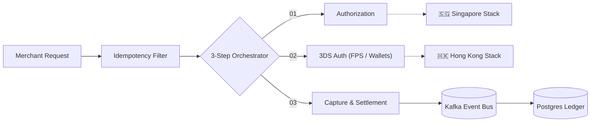

  

  <a href="https://linkedin.com/in/sujalvijayvargiya">LinkedIn</a> &nbsp;•&nbsp;
  <a href="mailto:sujalvj121@gmail.com">Email</a> &nbsp;•&nbsp;
  <a href="https://dsa-interviewer-bot.vercel.app">AlgoMentor (Live)</a> &nbsp;•&nbsp;
  <a href="https://github.com/vjsujal">GitHub</a>

 

### About

I am a Software Development Engineer at **[Juspay Technologies](https://juspay.in)** in Bangalore, working on high-scale payment infrastructure, multi-region platform automation, and resilient transaction orchestration across global markets.

Outside of fintech systems, I explore applied AI—particularly low-latency voice synthesis, conversational agents, and developer tooling.

---

### What I Build

#### `01` Payment Infrastructure & Regional Stacks
> Production systems powering critical transaction flows across Southeast Asia and India.

* **Singapore Stack Blueprint Automation:** Codified infrastructure topology into reusable provisioning blueprints, reducing new-region setup time from 6 weeks to 15 days across 5 core services (*Euler, PaymentPage, Recon, Dashboard, Morpheus*).
* **3-Step Payment Orchestration:** Built a decoupled transaction lifecycle framework separating Authorization, 3DS Authentication, and Capture to give enterprise merchants flexible routing and state management.
* **Native Wallet Integrations:** Shipped native SDK checkout flows for WeChatPay, Alipay, and FPS across Android and iOS in Singapore and Hong Kong markets.
* **Tech:** `Haskell` `Apache Kafka` `PostgreSQL` `Docker` `Microservices`

#### `02` AlgoMentor — AI Mock Interview Platform
> Real-time voice-interactive platform simulating FAANG-style algorithmic interviews.

* Generates adaptive DSA problems and contextual follow-up questions tailored to candidate code structure and reasoning.
* Integrates sub-second speech-to-text with neural text-to-speech for realistic conversational pacing.
* **Tech:** `Next.js` `FastAPI` `Python` `Groq (Llama-3.3-70B)` `AWS Polly` `PostgreSQL`
* **Links:** [Live Platform](https://dsa-interviewer-bot.vercel.app) &nbsp;|&nbsp; [Repository](https://github.com/vjsujal)

#### `03` Meeting Intelligence Pipeline
> Automated transcription, key decision extraction, and structured minutes generation.

* End-to-end pipeline processing multi-speaker audio recordings into structured, actionable minutes of meeting with action item assignment.
* **Tech:** `FastAPI` `React` `Gemini API` `AssemblyAI` `JWT`

---

### Architecture: Payment Orchestration Lifecycle

---

### Technical Toolkit

| Domain | Technologies |
|---|---|
| **Languages** | Python, TypeScript, JavaScript, Haskell, C/C++, SQL |
| **Backend & Distributed** | FastAPI, Node.js, Express, PostgreSQL, Redis, Apache Kafka, Microservices, Webhooks |
| **Frontend & Mobile** | Next.js (App Router), React, Tailwind CSS, Flutter, Dart |
| **AI & Speech** | Groq (Llama-3.3), Gemini API, AssemblyAI, AWS Polly, Scikit-Learn |
| **DevOps & Cloud** | Docker, Kubernetes, Linux, Git, GitHub Actions, GCP |

---

### Activity

  
  &nbsp;&nbsp;
  

  

---

  Bangalore, India &nbsp;•&nbsp; <a href="mailto:sujalvj121@gmail.com">sujalvj121@gmail.com</a>

