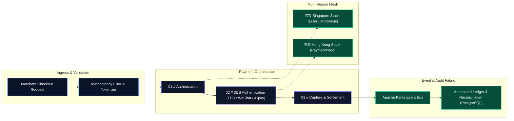
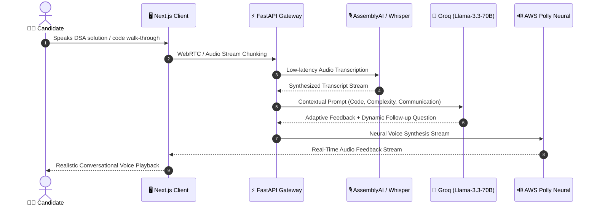

<!-- HERO BANNER (REFINED DARK LUXURY SVG) -->
<div align="center">
  
</div>

<br/>

<!-- SYSTEM TELEMETRY CARDS (METRIC MODULES) -->
<div align="center">
  
</div>

<br/>

<!-- LIVE TERMINAL SESSION -->
<div align="center">
  
</div>

<br/>

<!-- QUICK ACTION TRANSMISSIONS -->
<div align="center">
  <a href="https://linkedin.com/in/sujalvijayvargiya" target="_blank">
    
  </a>
  &nbsp;
  <a href="mailto:sujalvj121@gmail.com" target="_blank">
    
  </a>
  &nbsp;
  <a href="https://dsa-interviewer-bot.vercel.app" target="_blank">
    
  </a>
  &nbsp;
  <a href="https://github.com/vjsujal" target="_blank">
    
  </a>
</div>

<br/>

---

## ⚡ System Architecture & Execution Pipelines

### 1. Multi-Region Fintech & Payment Orchestration Engine
> *High-concurrency distributed payment infrastructure engineered at Juspay Technologies, powering enterprise merchant transactions across Singapore, Hong Kong, and India.*



---

### 2. Neural Audio & Adaptive Evaluation Pipeline (`AlgoMentor`)
> *Real-time FAANG-style DSA mock interview platform orchestrating speech streaming, LLM question synthesis, and automated scoring.*



---

## 📋 Production Audit & Impact Ledger

An audited log of production initiatives, scale breakthroughs, and open-source systems:

| Ledger ID | System / Domain | Operation & Focus | Status | Impact & Guarantees |
|:---:|---|---|:---:|---|
| `#JUS-SG01` | **Singapore Regional Stack** | Automated blueprint infrastructure codification | `🟢 PRODUCTION` | Slashed new market rollout from **6 weeks ➔ 15 days (-75%)** |
| `#JUS-WL02` | **Native Wallet SDKs** | Shipped WeChatPay, Alipay & FPS intent checkout | `🟢 PRODUCTION` | Seamless native Android/iOS wallet payments across SG & HK |
| `#JUS-OR03` | **3-Step Orchestration** | Decoupled Authorization, 3DS Authentication & Capture | `🟢 PRODUCTION` | Modular state machine lifecycle with 100% idempotency |
| `#DEV-AM04` | **AlgoMentor** | Real-time AI mock interview platform with neural voice | `🚀 LIVE SYSTEM` | Sub-second voice synthesis & adaptive evaluation (`Groq` + `AWS`) |
| `#DEV-MM05` | **Meeting Intelligence** | Automated audio transcription & action item extraction | `🚀 LIVE SYSTEM` | End-to-end meeting summaries using `Gemini API` & `FastAPI` |

---

## 🛠️ Engineering Loadout & System Capabilities

```
┌─────────────────────────┬──────────────────────────────────────────────────────────────────┐
│ DOMAIN                  │ TECHNOLOGIES & TOOLING RUNTIMES                                  │
├─────────────────────────┼──────────────────────────────────────────────────────────────────┤
│ ⚡ Payment & Core        │ Haskell (Pure FP) • Python 3.12 • TypeScript • C/C++ • SQL       │
│ 🛰️ Distributed Fabric   │ Apache Kafka • Redis (Distributed Caching & Limiters) • Postgres │
│ 🌐 Backend & Services   │ FastAPI (Async APIs) • Node.js • Microservices • Webhooks • REST │
│ 🧠 AI & Speech Systems  │ Groq (Llama-3.3-70B) • Gemini API • AWS Polly • AssemblyAI       │
│ 🖥️ Interface & Mobile   │ Next.js (App Router) • React 19 • Tailwind CSS • Flutter / Dart  │
│ 🛡️ DevOps & Infra       │ Docker • Kubernetes • Linux Server Administration • Git • Actions│
└─────────────────────────┴──────────────────────────────────────────────────────────────────┘
```

<div align="center">
  <a href="#">
    
  </a>
</div>

---

## 📊 Telemetry, Activity & Contribution Stream

<div align="center">
  <table border="0" cellspacing="0" cellpadding="0">
    <tr align="center">
      <td>
        
      </td>
      <td>
        
      </td>
    </tr>
    <tr align="center">
      <td colspan="2">
        <br/>
        
      </td>
    </tr>
  </table>
</div>

---

## 📡 Dispatch & Communication Protocols

```bash
$ ping -c 1 sujalvijayvargiya
PING sujal (12.9716° N, 77.5946° E [Bangalore, IN]): 56 data bytes
64 bytes from juspay-hq: icmp_seq=0 ttl=64 time=0.042 ms

--- Communication Channels Available ---
├── LinkedIn:  https://linkedin.com/in/sujalvijayvargiya
├── Email:     sujalvj121@gmail.com
├── Live App:  https://dsa-interviewer-bot.vercel.app
└── GitHub:    https://github.com/vjsujal
```

<div align="center">
  <sub>⚡ Engineered with precision &amp; architectural resilience by <b>Sujal Vijayvargiya</b></sub><br/>
  <sub><i>"Simplicity is prerequisite for reliability." — Edsger W. Dijkstra</i></sub>
</div>
