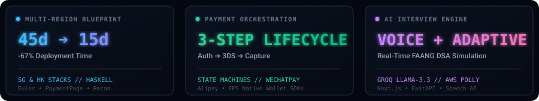
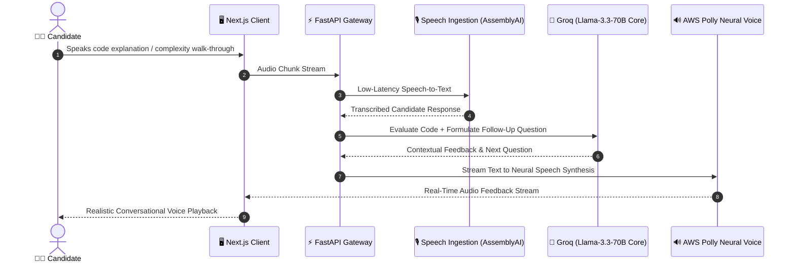

<!-- HERO BANNER (REFINED DARK LUXURY SVG) -->
<div align="center">
  
</div>

<br/>

<!-- SYSTEM TELEMETRY CARDS (PERSONAL PROJECTS HUD) -->
<div align="center">
  
</div>

<br/>

<!-- LIVE TERMINAL SESSION -->
<div align="center">
  
</div>

<br/>

<!-- QUICK ACTION TRANSMISSIONS -->
<div align="center">
  <a href="https://linkedin.com/in/sujalvijayvargiya" target="_blank">
    
  </a>
  &nbsp;
  <a href="mailto:sujalvj121@gmail.com" target="_blank">
    
  </a>
  &nbsp;
  <a href="https://dsa-interviewer-bot.vercel.app" target="_blank">
    
  </a>
  &nbsp;
  <a href="https://github.com/vjsujal" target="_blank">
    
  </a>
</div>

<br/>

---

## 🧑‍💻 Bio

> **SDE @ [Juspay](https://juspay.in)** building high-scale payment infrastructure and distributed state machines.  
> After hours, I architect **voice-interactive AI platforms and intelligent developer tools** (built [AlgoMentor](https://dsa-interviewer-bot.vercel.app)).  
> *Turning caffeine into idempotent distributed systems & clean abstractions.* ☕⚡

---

## 🚀 Featured Personal Projects

### `01` [AlgoMentor](https://dsa-interviewer-bot.vercel.app) — AI Mock Interview Platform
> Real-time voice-interactive platform simulating FAANG-style algorithmic interviews with adaptive questioning and automated evaluation.

* **Adaptive AI Reasoning:** Leverages Groq Llama-3.3-70B for low-latency contextual evaluation, assessing code structure, time/space complexity, and communication clarity.
* **Neural Voice Synthesis:** Integrated AWS Polly for low-latency, natural interviewer voice playback with conversational speech pacing.
* **Stack:** `Next.js` `FastAPI` `Python` `Groq (Llama-3.3-70B)` `AWS Polly` `PostgreSQL` `JWT Auth`
* **Links:** [Live Platform ↗](https://dsa-interviewer-bot.vercel.app) &nbsp;|&nbsp; [GitHub Repository ↗](https://github.com/vjsujal)

---

### `02` AI Minutes of Meeting (MoM) Generator
> End-to-end meeting intelligence pipeline transcribing audio and synthesizing structured, actionable minutes.

* **Audio Intelligence:** Automated speech-to-text pipeline using AssemblyAI to handle multi-speaker meeting recordings.
* **Structured Synthesis:** Uses Google's Gemini API with structured outputs to extract core decisions, key takeaways, and assignable action items.
* **Stack:** `FastAPI` `React.js` `Gemini API` `AssemblyAI` `Python` `JWT Auth`
* **Links:** [GitHub Repository ↗](https://github.com/vjsujal)

---

### `03` LongToShorts — Automated Video Intelligence
> AI-powered pipeline extracting concise, high-engagement short-form videos from long-form content.

* **NLP Hook Extraction:** Analyzes audio transcripts with spaCy and Google Generative AI to identify high-retention moments and viral narrative hooks.
* **Automated Video Processing:** Programmatically cuts, frames, and renders vertical video clips ready for YouTube Shorts and Reels using MoviePy.
* **Stack:** `Python` `Google GenAI` `MoviePy` `spaCy` `AssemblyAI`
* **Links:** [GitHub Repository ↗](https://github.com/vjsujal)

---

## ⚡ Architecture: AlgoMentor Voice & Evaluation Pipeline



---

## 🛠️ Engineering Loadout & System Capabilities

```
┌─────────────────────────┬──────────────────────────────────────────────────────────────────┐
│ DOMAIN                  │ TECHNOLOGIES & TOOLING RUNTIMES                                  │
├─────────────────────────┼──────────────────────────────────────────────────────────────────┤
│ ⚡ Core Languages        │ Python 3.12 • TypeScript • JavaScript • Haskell • C/C++ • SQL    │
│ 🛰️ Distributed Systems  │ Apache Kafka • Redis (Caching & Rate Limiting) • PostgreSQL ACID │
│ 🌐 Backend Services     │ FastAPI (Async APIs) • Node.js • Express • Microservices • REST  │
│ 🧠 AI & Speech Systems  │ Groq (Llama-3.3-70B) • Gemini API • AWS Polly • AssemblyAI       │
│ 🖥️ Frontend & UI        │ Next.js (App Router) • React 19 • Tailwind CSS • Flutter / Dart  │
│ 🛡️ DevOps & Cloud       │ Docker • Kubernetes • Linux Administration • Git • GitHub Actions│
└─────────────────────────┴──────────────────────────────────────────────────────────────────┘
```

<div align="center">
  <a href="#">
    
  </a>
</div>

---

## 📊 Activity & Contribution Stream

<div align="center">
  <table border="0" cellspacing="0" cellpadding="0">
    <tr align="center">
      <td>
        
      </td>
      <td>
        
      </td>
    </tr>
    <tr align="center">
      <td colspan="2">
        <br/>
        
      </td>
    </tr>
  </table>
</div>

---

## 📡 Dispatch & Communication Protocols

```bash
$ ping -c 1 sujalvijayvargiya
PING sujal (Bangalore, IN): 56 data bytes
64 bytes from local-station: icmp_seq=0 ttl=64 time=0.042 ms

--- Communication Channels Available ---
├── LinkedIn:  https://linkedin.com/in/sujalvijayvargiya
├── Email:     sujalvj121@gmail.com
├── Live App:  https://dsa-interviewer-bot.vercel.app
└── GitHub:    https://github.com/vjsujal
```

<div align="center">
  <sub>⚡ Engineered with precision &amp; architectural resilience by <b>Sujal Vijayvargiya</b></sub><br/>
  <sub><i>"Simplicity is prerequisite for reliability." — Edsger W. Dijkstra</i></sub>
</div>
